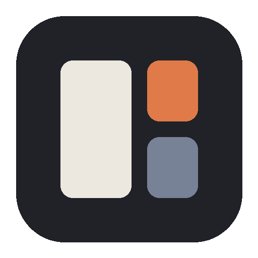
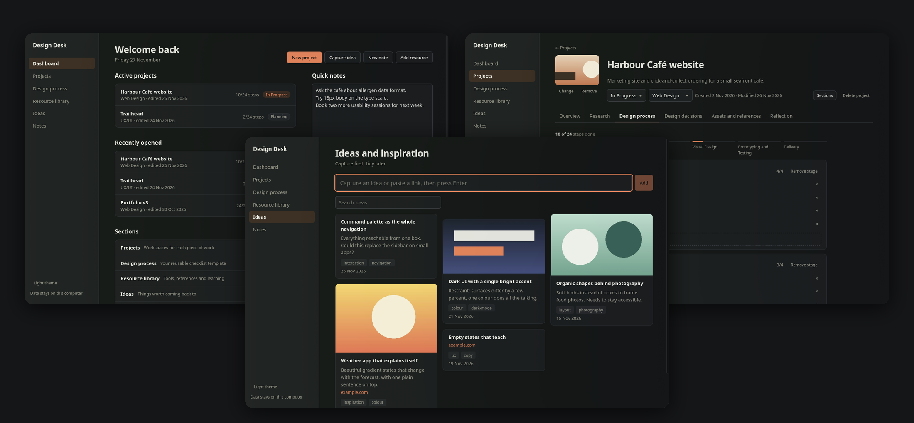
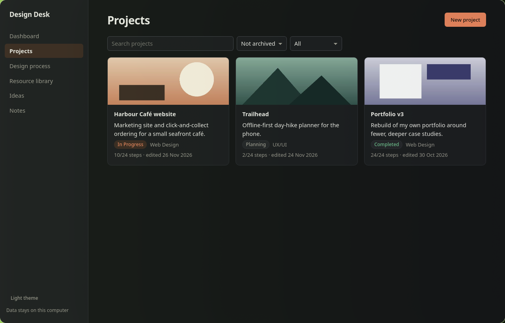
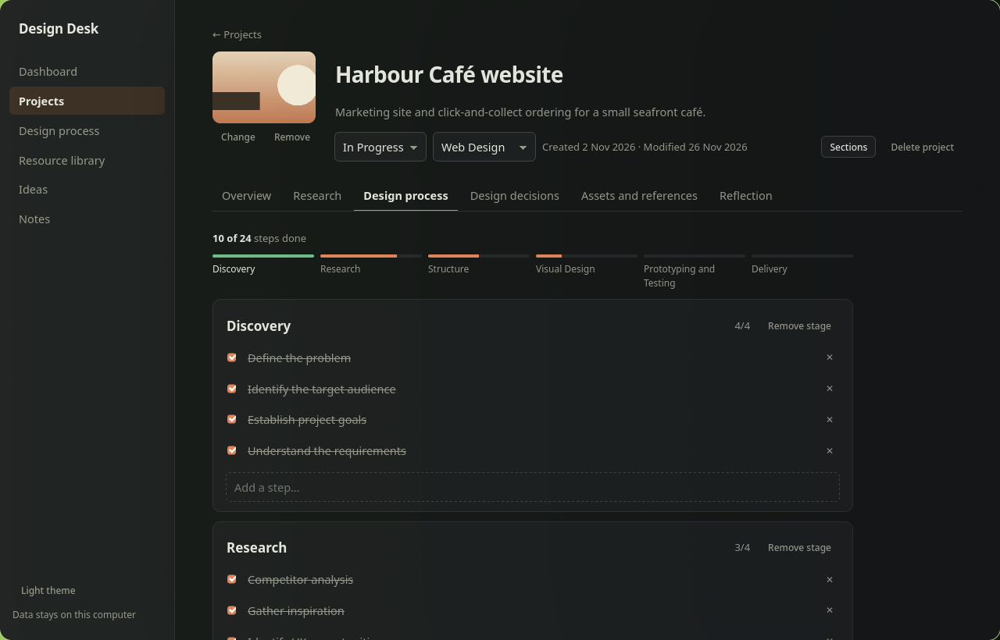
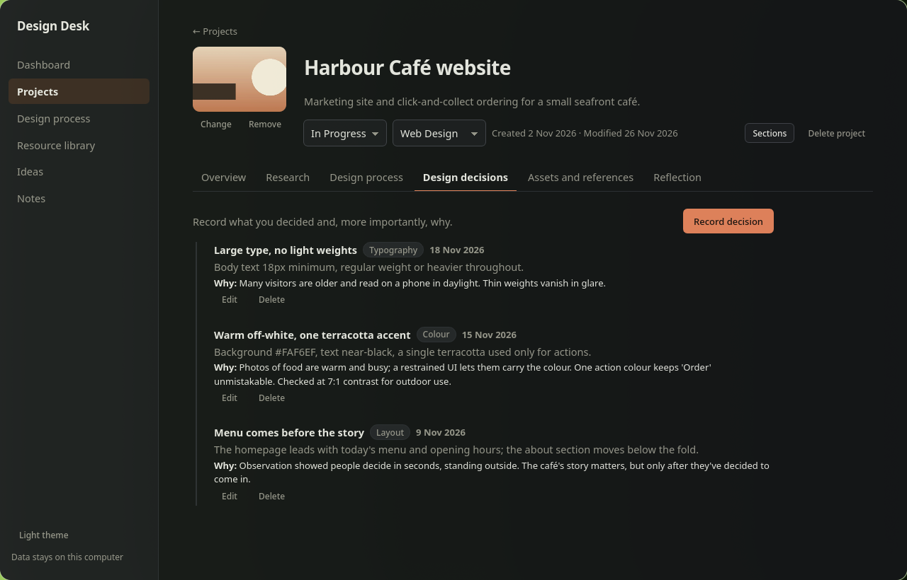
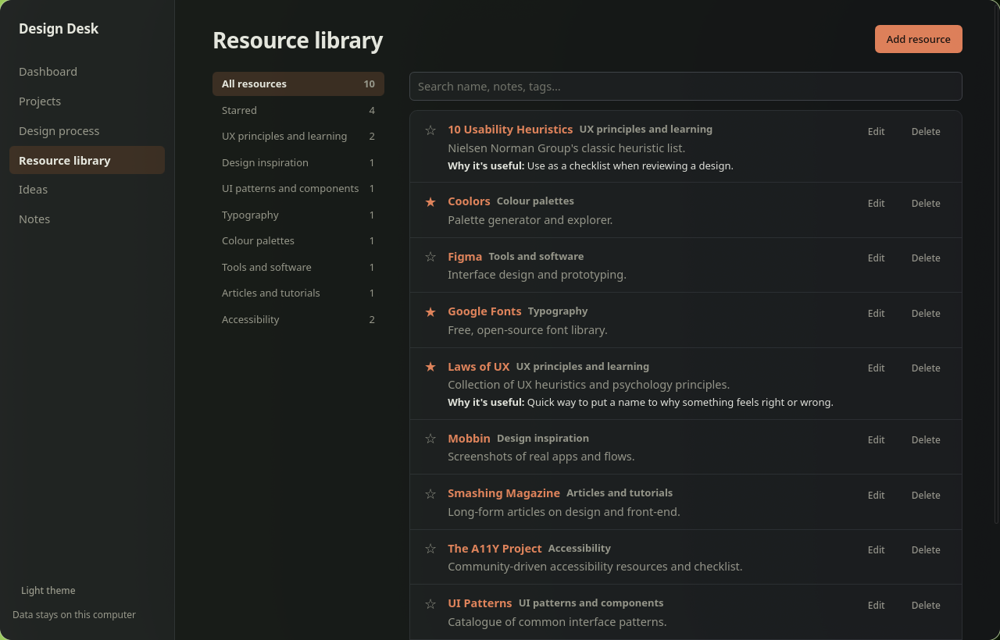
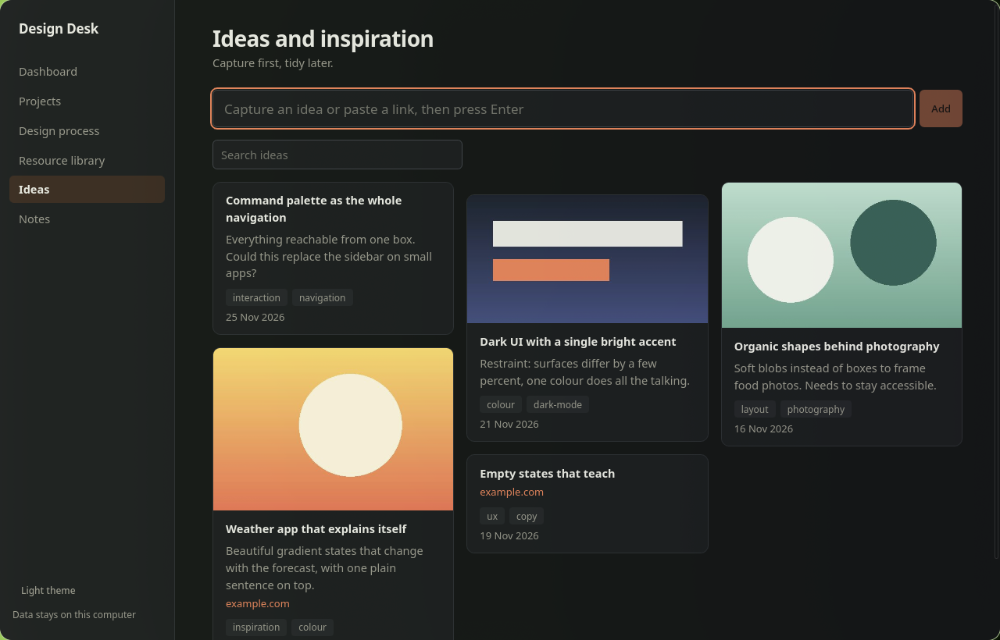
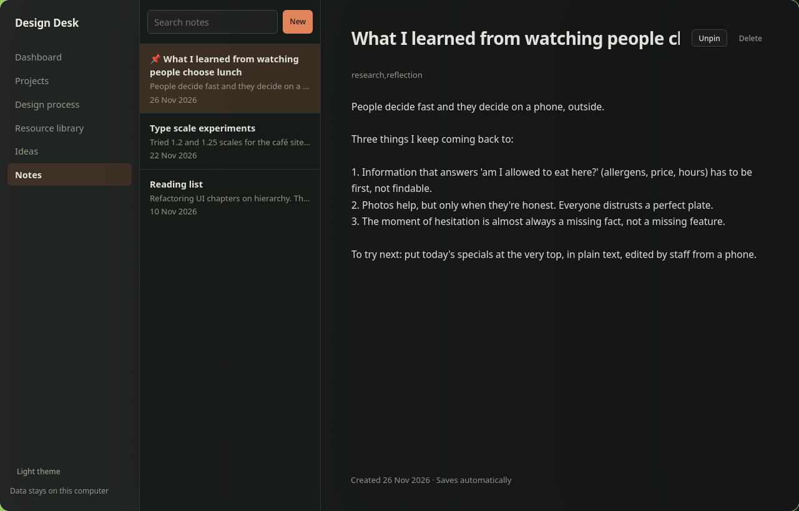

<div align="center">



# Design Desk

**A quiet desktop workspace for design work: projects, process, references and reflection, all in one place and all on your machine.**

Design tools are great at making things and bad at remembering why. Design Desk keeps the thinking around the work: the brief, the research, the process you followed, the decisions you made and what you learned. No accounts, no cloud, no subscription.

[](https://tauri.app)
[](https://www.rust-lang.org)
[](https://react.dev)
[](https://www.typescriptlang.org)
[](#where-your-data-lives)

<br />



</div>

<br />

## Features

- **A dashboard that stays useful.** What's in progress, what you opened recently, a scratchpad for stray thoughts and your starred resources. No charts, no streaks.
- **A workspace for every project.** Name, description, status (Planning, In Progress, Completed, Archived), category and an optional cover. Inside: **Overview** (brief, problem, audience, goals), **Research** (notes, competitor analysis, references), **Design process**, **Design decisions**, **Assets and references** and **Reflection**. Not every project needs every section, so hide the ones you don't want.
- **A design process you own.** A reusable six-stage checklist (Discovery, Research, Structure, Visual Design, Prototyping and Testing, Delivery) to start new projects from. Edit it, add to it, remove from it. A project gets its own copy, so changing one never touches the other. It's a guide, not a rulebook.
- **Decisions with reasons.** Record what you chose (layout, colour, type, interaction) and, more importantly, why. Newest first, so you build a history you can actually use in a case study.
- **A resource library.** Eight categories, search, tags, personal notes on *why* each one is useful, and a star to pin favourites to the dashboard. It starts with a few classics you can delete.
- **Ideas, quickly.** Type a thought and press Enter. Paste a link and it becomes an idea with a URL. Add an image, notes and tags later, or never.
- **Notes that get out of the way.** A plain writing space with autosave, tags, pinning and search.
- **Saves as you type.** Fields save themselves a moment after you stop typing, and again when you leave them or close the page. There is no save button to forget.
- **Light and dark.** Follows your system and can be switched in the sidebar.
- **Local and private.** One SQLite file on your computer. Links open in your normal browser. The app makes no network requests of its own.

## Screenshots

<table>
  <tr>
    <td align="center"><br /><sub>Projects</sub></td>
    <td align="center"><br /><sub>A project's design process, with progress per stage</sub></td>
  </tr>
  <tr>
    <td align="center"><br /><sub>Design decisions and the reasons behind them</sub></td>
    <td align="center"><br /><sub>The resource library</sub></td>
  </tr>
  <tr>
    <td align="center"><br /><sub>Ideas and inspiration</sub></td>
    <td align="center"><br /><sub>Notes</sub></td>
  </tr>
</table>

<sub>All projects, notes and ideas shown are invented demo content.</sub>

## How it works

| Layer | What it does |
| --- | --- |
| **Tauri 2** | A small native shell around the system webview, so the app is a light Rust binary rather than a bundled browser. |
| **SQLite (`rusqlite`)** | All data lives in one file. SQLite is compiled in, so there is nothing to install. Migrations are tracked with `PRAGMA user_version`. |
| **Generic CRUD** | `db.rs` exposes `list`, `insert`, `update` and `delete` for a whitelist of tables. Table names come from the whitelist, column names are checked against the schema, and values are always bound parameters. The UI never needs a Rust command per entity. |
| **Project bookkeeping** | Writing anything that belongs to a project (a note, a decision, a checklist step) bumps its "modified" date in the same transaction. |
| **React + TypeScript** | One file per section in `src/pages`. A small hash router, no UI framework. |
| **Design tokens** | Every colour, size and space is a CSS variable in `tokens.css`, so restyling the whole app starts in one file. |

```
src-tauri/src/
├── schema.rs        tables, migrations, default process, starter resources
├── db.rs            connection, migrations, generic CRUD, tests
├── commands.rs      Tauri commands exposed to the UI
└── main.rs          app setup

src/
├── pages/           dashboard, projects, workspace, process, resources, ideas, notes
├── components/      modal, autosave text, link list, process editor, sidebar
├── lib/             API wrapper, router, hooks, helpers
└── styles/          tokens.css (the look) and app.css (the layout)
```

## Build it

You need [Node](https://nodejs.org), [Rust](https://rustup.rs) and Tauri's system dependencies. On Arch that is `webkit2gtk-4.1` and a C compiler; other platforms are covered in the [Tauri prerequisites](https://tauri.app/start/prerequisites/).

```sh
git clone git@github.com:0sian/Design-Desk.git
cd Design-Desk
npm install
npm run dev        # development window with hot reload
npm run build      # release binary: src-tauri/target/release/design-desk
```

The first Rust build takes a minute or two. To run the database tests:

```sh
cd src-tauri && cargo test
```

Built and tested on Linux. Tauri also targets Windows and macOS, but I haven't tried them.

## Where your data lives

Everything is in one file: `~/.local/share/dev.designdesk.app/design-desk.db` on Linux. Images are stored inside it, so backing up or moving Design Desk is copying that one file.

## Roadmap

- [ ] Reorder checklist steps and stages
- [ ] Markdown in notes
- [ ] Export and import as a backup from inside the app
- [ ] A desktop launcher and packaged installers
- [ ] Windows and macOS builds
- [ ] A proper visual design pass

## License

[MIT](LICENSE)

## Credits

Built with [Tauri](https://tauri.app), [React](https://react.dev) and [SQLite](https://sqlite.org).
